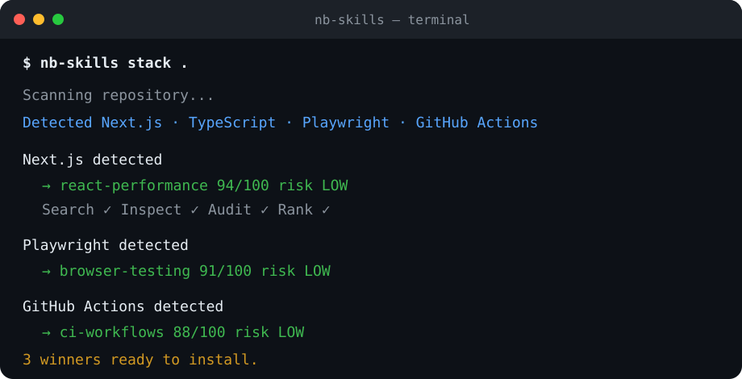

# nb-skills

<p align="center">
  <strong>Stop hunting for Agent Skills by hand.</strong><br/>
  Search multiple registries, inspect source, audit risk, rank candidates, and install the right skill for the job.
</p>

<p align="center">
  <a href="https://github.com/arce-star/nb-skills/actions/workflows/ci.yml"></a>
  
  
  
  
</p>

<p align="center">
  
</p>

## One command, a ranked skill stack

Point `nb-skills` at a repository:

```bash
nb-skills stack .
```

It detects the project, turns the stack into search intents, searches multiple Agent Skill registries, inspects GitHub-backed `SKILL.md` files, runs static security checks, ranks the candidates, and returns a small install-ready shortlist.

```text
Skill stack for: ./my-next-app

Next.js detected
  → vercel-labs/agent-skills@vercel-react-best-practices — 94/100 · risk low
    via skills.sh, skillsmp
    npx skills add vercel-labs/agent-skills@vercel-react-best-practices

Playwright detected
  → @publisher/browser-testing — 86/100 · registry-only
    via clawhub
    openclaw skills install @publisher/browser-testing
```

## Multi-source discovery

By default every search fans out across:

- **skills.sh** — ecosystem install/popularity signals;
- **SkillsMP** — large GitHub-backed catalog with source URLs;
- **ClawHub** — registry-native semantic/vector search;
- **GitHub repository search** — last-resort fallback when structured registries produce no usable results.

```bash
nb-skills search "react performance"
nb-skills search "react performance" --providers skills.sh,skillsmp
```

Results that point to the same GitHub `owner/repo@skill` are deduplicated while preserving every registry that discovered them. One provider timing out or hitting a rate limit does not break the other providers.

> Registry-only results are never presented as though they passed the GitHub static auditor. If the source cannot be inspected, nb-skills says so explicitly.

## Why nb-skills?

Finding a skill is easy. Deciding **which one fits, whether it is maintained, whether multiple registries agree on it, and whether you should trust it enough to install** is the hard part.

| Capability | Basic finder | nb-skills |
| --- | ---: | ---: |
| Search skills | Yes | Yes |
| Search multiple registries | Usually no | Yes |
| Understand task intent | Manual | Yes |
| Deduplicate cross-registry results | No | Yes |
| Inspect `SKILL.md` | Manual | Yes |
| Static security audit | No | Yes |
| Quality + relevance ranking | No | Yes |
| Compare alternatives | Manual | Yes |
| Detect skills for a codebase | No | Yes |
| Produce a ranked skill stack | No | Yes |
| Degrade gracefully when a registry fails | No | Yes |

## Quick start

### Install as an Agent Skill

```bash
npx skills add arce-star/nb-skills --skill nb-skills
```

Then ask your agent:

```text
Find the best skill for reviewing React performance.
Audit this skill before I install it.
Compare these candidates and pick one.
Find the best skill stack for this repository.
```

### Use the CLI

```bash
git clone https://github.com/arce-star/nb-skills.git
cd nb-skills
npm install

node skills/nb-skills/scripts/nb-skills.mjs search "react performance"
node skills/nb-skills/scripts/nb-skills.mjs recommend "review pull requests for security"
node skills/nb-skills/scripts/nb-skills.mjs audit owner/repo@skill
node skills/nb-skills/scripts/nb-skills.mjs stack .
```

After npm publication, the intended interface is simply:

```bash
npx nb-skills stack .
```

## Commands

```text
nb-skills search <query>                 Multi-source discovery
nb-skills recommend <query>              Search + inspect + audit + rank
nb-skills audit <owner/repo@skill>       Static security and quality audit
nb-skills compare <skill> <skill> ...    Compare audited GitHub candidates
nb-skills project [path]                  Detect project → search intents
nb-skills stack [path]                    Detect → multi-search → audit → rank winners
nb-skills install <owner/repo@skill>      Delegate GitHub installation to skills CLI
nb-skills doctor                          Check runtime, providers, and API-key availability
```

Most discovery commands accept:

```bash
--providers skills.sh,skillsmp,clawhub
```

or globally:

```bash
NBSKILLS_PROVIDERS=skills.sh,clawhub nb-skills search "database migration"
```

## The ranking model

A recommendation is scored out of 100:

- **Relevance — 40**
- **Quality — 20**
- **Trust / security — 15**
- **Popularity — 10**
- **Freshness — 10**
- **Compatibility — 5**

Popularity is deliberately not the objective: a huge skill that poorly matches your task should lose to a smaller, better-fit skill.

## Security before install

```bash
nb-skills audit owner/repo@skill
```

The static auditor looks for destructive shell commands, `curl | bash`, secret and SSH credential access, encoded payloads, process execution, network access, and prompt-injection-like instructions.

> A clean audit is **not** a security certification. It is a transparent heuristic designed to surface risks before installation.

For a registry result without a GitHub source, the CLI reports `registry-only` / `audit unavailable` instead of assigning fabricated security findings.

## How it works

```text
User task / repository
        ↓
Intent / project detection
        ↓
┌────────────┬────────────┬───────────┐
│ skills.sh  │ SkillsMP   │ ClawHub   │
└──────┬─────┴──────┬─────┴─────┬─────┘
       └──── normalize + dedupe ─┘
                    ↓
       GitHub source inspection
                    ↓
             Static audit
                    ↓
   Relevance + quality + trust ranking
                    ↓
          Shortlist / skill stack
                    ↓
           User-approved install
```

If structured registries return no usable result, GitHub repository search is used as a lower-precision fallback.

## Discovery providers

### skills.sh

Uses the same search surface used by the public skills ecosystem. The endpoint is treated as experimental because it is not documented as a stable public API contract.

### SkillsMP

Uses the documented `GET /api/v1/skills/search` REST endpoint. Anonymous search currently has a low daily quota; set `SKILLSMP_API_KEY` for the higher documented authenticated quota.

```bash
SKILLSMP_API_KEY=... nb-skills search "playwright testing"
```

### ClawHub

Uses the documented public `GET /api/v1/search` endpoint with `nonSuspiciousOnly=true`. ClawHub explicitly supports third-party catalog reuse of its public read API. Registry-only skills use the registry-native install command:

```bash
openclaw skills install @owner/slug
```

### GitHub fallback

Used only when the configured structured providers fail or return no usable candidates. Set `GITHUB_TOKEN` or `GH_TOKEN` for better metadata-enrichment rate limits.

See [`skills/nb-skills/references/sources.md`](skills/nb-skills/references/sources.md) for provider contracts and rate-limit behavior.

## Repository layout

```text
nb-skills/
├── README.md
├── package.json
├── skills/
│   └── nb-skills/
│       ├── SKILL.md
│       ├── scripts/
│       │   ├── nb-skills.mjs
│       │   ├── providers.mjs
│       │   ├── search.mjs
│       │   ├── audit.mjs
│       │   ├── github.mjs
│       │   ├── core.mjs
│       │   └── validate.mjs
│       └── references/
│           ├── ranking.md
│           ├── security.md
│           └── sources.md
└── tests/
```

The installable skill lives under `skills/nb-skills/` rather than at repository root, so skill installers can copy the skill itself without treating the whole development repository as skill payload.

## Design principles

1. **Coverage without lock-in.** Registries are providers, not the architecture.
2. **Relevance beats stars.** Popularity is useful evidence, not the objective.
3. **Inspect before recommending.** Descriptions are advertising; source is the product.
4. **Audit before installing.** Agent instructions and bundled scripts are part of the supply chain.
5. **No fake confidence.** Registry-only results are labeled when source inspection is unavailable.
6. **Graceful degradation.** One broken provider must not break discovery.
7. **Small shortlists.** Three reasoned recommendations are usually better than fifty links.
8. **No silent installs.** Discovery and installation are separate decisions.

## Status

`v0.3.0` introduces the multi-source provider layer: skills.sh + SkillsMP + ClawHub, cross-registry normalization/deduplication, provider-failure isolation, and GitHub fallback.

Planned directions:

- provider-aware caching and quota budgeting;
- richer compatibility detection;
- deeper ClawHub detail/security integration;
- transitive script/reference inspection;
- a pluggable external provider manifest;
- GitHub Action for auditing skill changes in pull requests.

## Contributing

Issues and pull requests are welcome. See [CONTRIBUTING.md](CONTRIBUTING.md).

## License

MIT

> Note: GitHub-backed installation delegates to the upstream `skills` CLI. Registry-only providers may require their own native installer. Search, normalization, ranking, project detection, and static GitHub-source audit are implemented by nb-skills itself.
